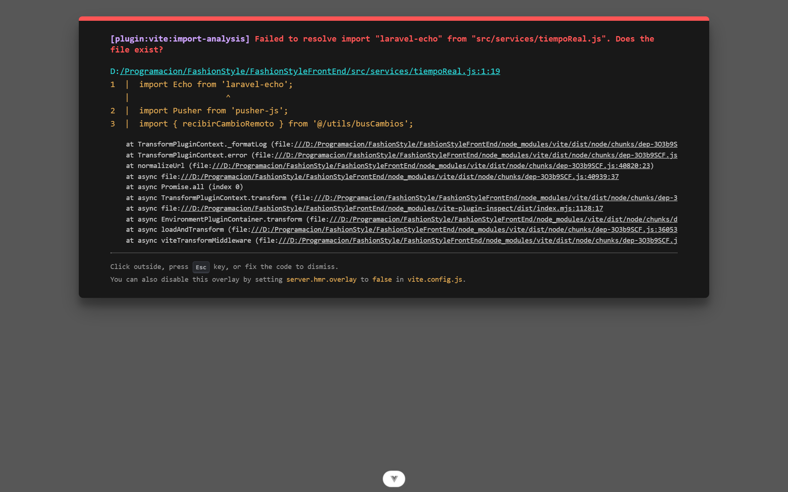

# 📖 Manual de Usuario y Guía de Operación
## Plataforma Omnicanal Fashion Style (Web & Mobile)

**Sistema:** Fashion Style — E-Commerce, Punto de Venta POS & Manufactura Textil  
**Programa:** Análisis y Desarrollo de Software (ADSO) — SENA  
**Versión del Software:** 2.0.0 Productiva  
**Entorno Web Oficial:** `https://fashionstylegrupo3.github.io/FashionStyleDist/`  
**API REST Central:** `https://fashionstyle.api.adsocidm.com/public/api`  

---

## 📑 Tabla de Contenidos
1. [Introducción y Estructura por Roles](#1-introducción-y-estructura-por-roles)
2. [Rol 1: Visitante / Usuario Público](#2-rol-1-visitante--usuario-público)
3. [Rol 2: Cliente / Usuario Registrado](#3-rol-2-cliente--usuario-registrado)
4. [Rol 3: Empleado / Operador de Tienda (Staff)](#4-rol-3-empleado--operador-de-tienda-staff)
5. [Rol 4: Administrador del Sistema](#5-rol-4-administrador-del-sistema)
6. [Anexo: Guion para Videos Explicativos por Rol (Minuto a Minuto)](#6-anexo-guion-para-videos-explicativos-por-rol-minuto-a-minuto)

---

## 1. Introducción y Estructura por Roles

El presente manual describe paso a paso la interacción operativa con la plataforma **Fashion Style**, tanto en su versión Web como en su aplicación Móvil. El acceso a las funcionalidades está estrictamente segmentado según los **cuatro roles del sistema**:

```text
+---------------------------------------------------------------------------------------+
|                                    NIVELES DE ACCESO                                  |
+---------------------------------------------------------------------------------------+
|  [ VISITANTE ]  -->  Exploración de catálogo, guía de tallas y bolsa de cotización.   |
|  [  CLIENTE  ]  -->  Registro, perfil, favoritos, checkout Wompi y rastreo de pedidos.|
|  [ EMPLEADO  ]  -->  Caja POS física, despacho de envíos e inventario de tienda.      |
|  [   ADMIN   ]  -->  Dashboard KPIs, costeo textil (BOM), facturación, roles y logs.  |
+---------------------------------------------------------------------------------------+
```

---

## 2. Rol 1: Visitante / Usuario Público

El usuario visitante puede explorar libremente la boutique digital sin necesidad de contar con credenciales de acceso.

### 2.1. Exploración de la Portada Principal (Home)
Al ingresar al portal, el visitante visualiza el escaparate digital con promociones vigentes, carrusel de novedades y acceso directo a colecciones de temporada.


* **Paso 1:** Navegue por el encabezado superior para visualizar las categorías maestras (*Vestidos, Blusas, Pantalones, Calzado*).
* **Paso 2:** Haga clic sobre el banner de temporada o sobre el botón **"Explorar Colección"** para dirigirse a los artículos destacados.

---

### 2.2. Navegación del Catálogo y Filtros Facetados
El catálogo permite realizar búsquedas instantáneas y filtrado simultáneo por múltiples criterios.


* **Paso 1:** Ingrese un término en la barra de búsqueda (ej. `"lino"`, `"camisa"`).
* **Paso 2:** Seleccione una o más opciones del panel lateral de filtros:
  - **Categoría:** *Vestidos de Temporada, Básicos de Lino*.
  - **Talla:** *XS, S, M, L, XL*.
  - **Color:** Paleta visual (*Arena, Negro, Crema, Terracota*).
  - **Rango de Precios:** Deslizador dinámico entre `$ 40.000` y `$ 350.000 COP`.
* **Paso 3:** Ordene los resultados por *Menor Precio*, *Mayor Precio* o *Novedades*.

---

### 2.3. Ficha de Detalle de Prenda y Guía de Medidas
Al seleccionar una prenda, se abre su ficha técnica comercial con selector interactivo de variantes.


* **Paso 1:** Inspeccione la galería fotográfica de alta resolución interactuando con las miniaturas.
* **Paso 2:** Seleccione la **Talla** y el **Color** deseados. Note cómo el indicador de stock se actualiza en tiempo real mostrando las unidades disponibles.
* **Paso 3:** Si tiene dudas sobre la horma, haga clic en **"Guía de Medidas"** para desplegar el modal interactivo con equivalencias anatómicas en centímetros (busto, cintura, cadera).
* **Paso 4:** Seleccione la cantidad y presione el botón **"Agregar a la Bolsa"**.

---

### 2.4. Bolsa de Compras y Cotización Express
Permite revisar los artículos preseleccionados antes de iniciar el pago.


* **Paso 1:** Abra el cajón lateral de la bolsa desde el icono de bolsa en la esquina superior derecha.
* **Paso 2:** Ajuste las unidades o elimine variantes si es necesario.
* **Paso 3:** Para una consulta directa con el personal de tienda, use la función **"Cotizar por WhatsApp"**, la cual genera un enlace con el desglose exacto de su pedido.
* **Paso 4:** Presione **"Proceder al Pago"**. Si no ha iniciado sesión, el sistema lo dirigirá automáticamente a la pantalla de autenticación.

---

## 3. Rol 2: Cliente / Usuario Registrado

El cliente registrado cuenta con un entorno personalizado para gestionar sus pedidos, direcciones y métodos de pago.

### 3.1. Registro de Nueva Cuenta
Permite al comprador crear una identidad protegida en la tienda.


* **Paso 1:** Haga clic en **"Crear Cuenta"** en el encabezado.
* **Paso 2:** Complete el formulario con los siguientes **Datos Fake de Prueba**:

| Campo del Formulario | Dato Fake de Prueba |
| :--- | :--- |
| **Nombre Completo** | `Mariana Gómez Restrepo` |
| **Correo Electrónico** | `mariana.gomez@testmail.com` |
| **Número de Teléfono** | `3127894561` |
| **Contraseña** | `ModaSegura2026*` |
| **Confirmar Contraseña** | `ModaSegura2026*` |

* **Paso 3:** Observe el validador reactivo de contraseña: los indicadores se tornarán verdes al cumplir con longitud mínima (8 caracteres), mayúscula, minúscula, número y símbolo.
* **Paso 4:** Acepte los Términos y Condiciones y presione **"Registrarse"**.

---

### 3.2. Verificación de Correo Electrónico (Código OTP)
Por seguridad y mitigación de fraude, el sistema requiere confirmación de titularidad de correo.


* **Paso 1:** Revise su bandeja de entrada. Recibirá un código numérico de 6 dígitos con vigencia de 15 minutos.
* **Paso 2:** Ingrese el código en las casillas correspondientes:
  - **Código Fake de Prueba:** `742918`
* **Paso 3:** Presione **"Verificar Cuenta"**. El sistema confirmará su perfil y abrirá la sesión.

---

### 3.3. Inicio de Sesión
Permite ingresar a través de credenciales locales o mediante Google OAuth 2.0.


* **Opción A (Credenciales Tradicionales):**
  - **Correo:** `mariana.gomez@testmail.com`
  - **Contraseña:** `ModaSegura2026*`
  - Presionar **"Iniciar Sesión"**.
* **Opción B (Acceso Social):**
  - Presionar el botón **"Continuar con Google"** para autenticarse con su cuenta de Google en un solo clic.

---

### 3.4. Gestión del Perfil y Seguridad (2FA)
Permite al cliente actualizar sus datos personales, avatar y credenciales.


* **Paso 1:** Acceda a **"Mi Perfil"** desde el menú de usuario.
* **Paso 2:** Haga clic en el avatar para subir una foto de perfil personalizada (`.png`, `.jpg`).
* **Paso 3:** En la sección de dirección, utilice el autocompletado geográfico seleccionando Departamento (*Antioquia*) y Municipio (*Medellín*).
* **Paso 4:** En la sección **"Seguridad"**, active la verificación en dos pasos (2FA) para requerir confirmación OTP en cada inicio de sesión nuevo.

---

### 3.5. Historial de Pedidos y Rastreo de Envíos
Muestra el estado en tiempo real de las compras efectuadas.


* **Paso 1:** Ingrese a la pestaña **"Mis Pedidos"** en el panel de perfil.
* **Paso 2:** Consulte el listado histórico con estado (`Pendiente`, `En Preparación`, `Enviado`, `Entregado`).
* **Paso 3:** Al hacer clic en un pedido despachado, visualice la **Transportadora** asignada (*Coordinadora, Envia, Servientrega*) y el **Número de Guía** para rastreo directo.

---

### 3.6. Prendas Favoritas (Lista de Deseos)
Permite guardar artículos para compras futuras con sincronización en la nube.


* **Paso 1:** Al navegar por el catálogo o detalle, presione el icono de **Corazón** en cualquier prenda.
* **Paso 2:** Ingrese a la sección **"Favoritos"** de su perfil para ver sus prendas guardadas, verificar disponibilidad de stock o transferirlas a la bolsa de compras en un solo clic.

---

### 3.7. Proceso de Checkout y Pasarela Wompi
Flujo de compra seguro con reserva transaccional de stock.


* **Paso 1:** Desde la bolsa de compras, presione **"Pagar con Wompi"**.
* **Paso 2:** El sistema bloqueará el stock de las prendas por **15 minutos** e iniciará el widget certificado de Wompi.
* **Paso 3:** Seleccione el medio de pago deseado e ingrese los datos de prueba:

#### Datos Fake para Pruebas en Sandbox Wompi:
| Método de Pago | Campo | Dato de Prueba |
| :--- | :--- | :--- |
| **Tarjeta de Crédito** | Número | `4242 4242 4242 4242` |
| | Fecha Expira | `12/28` |
| | CVC | `123` |
| | Nombre | `Mariana Gómez` |
| **Nequi** | Número de Celular | `3991111111` (Aprobación directa en sandbox) |
| **PSE** | Banco | `Banco Unión Colombiano (Sandbox)` |
| | Tipo de Persona | `Natural` |
| | Documento | `CC 1020304050` |

* **Paso 4:** Una vez confirmada la transacción, el sistema emitirá la factura digital y registrará el pedido en estado `Aprobado`.

---

## 4. Rol 3: Empleado / Operador de Tienda (Staff)

El empleado se encarga de la atención presencial, cobro en caja física, despacho de paquetes y control de piso.

### 4.1. Punto de Venta (POS Físico) en Mostrador
Diseñado para registrar ventas físicas presenciales de forma instantánea.


* **Paso 1:** Ingrese al módulo **"Punto de Venta (POS)"** desde el menú lateral.
* **Paso 2:** Seleccione las prendas mediante la cuadrícula rápida o digite el código SKU en la barra de búsqueda rápida.
* **Paso 3:** Seleccione la talla y color solicitados por el cliente en tienda.

---

### 4.2. Modal de Cobro Rápido y Tirilla Térmica Roll-80
Procesa el pago en efectivo o datáfono y emite el comprobante de venta.


* **Paso 1:** Presione el botón **"Cobrar"** (o presione la tecla de acceso rápido `F2`).
* **Paso 2:** Ingrese los **Datos Fake de la Venta**:

| Campo | Valor de Prueba |
| :--- | :--- |
| **Cliente** | `Consumidor Final (222222222222)` o seleccionar cliente frecuente |
| **Método de Pago** | `Efectivo en Caja` |
| **Total a Pagar** | `$ 153.000 COP` |
| **Efectivo Recibido** | `$ 200.000 COP` |
| **Cambio a Devolver** | `$ 47.000 COP` (Calculado automáticamente) |

* **Paso 3:** Presione **"Confirmar Venta e Imprimir"**.
* **Paso 4:** El visor gráfico generará el ticket térmico en formato continuo de 80 mm listo para imprimir o exportar a PDF.

---

### 4.3. Despacho y Logística de Pedidos Online
Gestión del ciclo de preparación y despacho de compras e-commerce.


* **Paso 1:** Ingrese a la sección **"Pedidos Online"**.
* **Paso 2:** Filtre los pedidos por estado `Pagado / Pendiente de Despacho`.
* **Paso 3:** Al empacar las prendas, presione **"Marcar como Despachado"** e ingrese los datos de la guía:
  - **Transportadora:** `Coordinadora Mercantil`
  - **Guía de Envío:** `78945612301`
* **Paso 4:** Guarde el registro. El cliente recibirá una notificación automática con los datos de seguimiento.

---

## 5. Rol 4: Administrador del Sistema

El Administrador tiene control integral sobre finanzas, manufactura, inventarios, seguridad y personal.

### 5.1. Dashboard y Métricas de Rendimiento (KPIs)
Consolida la información estratégica de ventas, inventario y finanzas en tiempo real.


* **Métricas Principales:**
  - **Ventas Totales del Día:** Sumatoria consolidada de mostrador físico POS y pedidos web Wompi.
  - **Pedidos Pendientes:** Órdenes pendientes de despacho logístico.
  - **Alertas de Stock Mínimo:** Lista de variantes con existencias inferiores al umbral de seguridad.
  - **Gráfico Comparativo de Ingresos:** Comparación semanal/mensual de canales digitales vs físicos.

---

### 5.2. Gestión de Catálogo de Prendas y Variantes
Módulo para dar de alta colecciones de moda con variantes dimensionales y cromáticas.



* **Paso 1:** Ingrese a **"Gestión de Prendas"** y presione **"+ Nueva Prenda"**.
* **Paso 2:** Ingrese los **Datos Fake del Producto**:

| Campo | Valor Fake de Prueba |
| :--- | :--- |
| **Nombre de la Prenda** | `Camisa Lino Cuello Mao` |
| **Categoría** | `Prendas Superiores / Camisas` |
| **Catálogo / Temporada** | `Colección Brisa de Verano 2026` |
| **Precio Base** | `$ 140.000 COP` |
| **Precio Venta** | `$ 119.000 COP` (15% descuento aplicado) |
| **Descripción Comercial**| `Camisa manga larga en lino fino pre-lavado con botones en concha natural.` |

* **Paso 3:** Agregue las variantes de talla y color:
  - *Variante 1:* Talla `M` | Color `Arena (#ECE5DA)` | Stock Inicial: `25` | SKU: `CAM-LINO-M-ARE`
  - *Variante 2:* Talla `L` | Color `Arena (#ECE5DA)` | Stock Inicial: `20` | SKU: `CAM-LINO-L-ARE`
* **Paso 4:** Cargue las fotografías promocionales y marque la imagen frontal como principal. Presione **"Guardar Prenda"**.

---

### 5.3. Kárdex e Inventario General de Almacén
Control contable de movimientos de entrada, salida, ajustes y devoluciones.


* **Paso 1:** Ingrese a **"Inventario / Kárdex"**.
* **Paso 2:** Consulte el stock desagregado por variante y almacén.
* **Paso 3:** Para realizar un ajuste manual (ej. ingreso de lote de confección), presione **"Registrar Movimiento"**:
  - **Tipo de Movimiento:** `Entrada por Producción`
  - **Variante:** `CAM-LINO-M-ARE`
  - **Cantidad:** `50`
  - **Motivo / Justificación:** `Recepción Orden OP-2026-088 taller central`
* **Paso 4:** Presione el botón **"Exportar a CSV"** para descargar el informe contable completo.

---

### 5.4. Facturación Omnicanal y Carga Masiva DIAN
Administración de comprobantes fiscales electrónicos unificados.


* **Paso 1:** Acceda a la pestaña **"Facturación"**.
* **Paso 2:** Observe el consecutivo unificado que vincula compras web y mostrador físico mediante la relación `factura_origen`.
* **Paso 3:** Para emitir una factura legal A4, haga clic sobre el registro y seleccione **"Ver Factura Estándar"**.
* **Paso 4:** Para subir paquetes de facturación externa, utilice la opción **"Carga Masiva Excel"** adjuntando la plantilla oficial DIAN.

---

### 5.5. Control Paralelo y Dispersión Financiera
Auditoría y conciliación cruzada multicanal.


* **Paso 1:** Diríjase al menú **"Control Financiero Paralelo"**.
* **Paso 2:** Compare los tres canales de recaudo:
  - **Recaudo Digital Wompi:** Total conciliado vía webhook.
  - **Efectivo en Caja POS:** Cuadre de caja diario contra registros de tickets.
  - **Transferencias Bancarias:** Comprobantes validados manualmente.
* **Paso 3:** Verifique que el indicador de discrepancia financiera permanezca en `$ 0 COP`.

---

### 5.6. Módulo de Manufactura y Confección Textil (BOM)
Sistema especializado de costeo industrial, fichas técnicas y órdenes de taller.

#### A. Materias Primas e Insumos

* Registre los insumos base con su unidad de medida y costo de adquisición:
  - *Materia Prima 1:* `Tela Lino 100% Crudo` | Unidad: `Metros` | Costo: `$ 22.000 COP / m`
  - *Materia Prima 2:* `Botones Concha Natural 18L` | Unidad: `Unidades` | Costo: `$ 450 COP / u`
  - *Materia Prima 3:* `Hilo Poliéster T-120 Arena` | Unidad: `Conos` | Costo: `$ 8.500 COP / cono`

#### B. Fórmulas de Producción (Lista de Materiales - BOM)

* Asocie a cada prenda sus consumos unitarios y el porcentaje técnico de desperdicio:
  - *Tela Lino:* `1.60 metros` | Merma estimada: `8.0%`
  - *Botones:* `8 unidades` | Merma estimada: `0.0%`
  - *Hilo:* `0.05 conos` | Merma estimada: `5.0%`

#### C. Calculadora y Simulador de Costeo

* Simule el costo de confección por lote antes de cortar tela:
  - **Prenda a Simular:** `Camisa Lino Cuello Mao`
  - **Tamaño del Lote:** `100 unidades`
  - **Tiempo de Confección:** `40 minutos / prenda`
  - **Costo Minuto Mano de Obra:** `$ 480 COP`
  - **Margen Comercial Deseado:** `45%`
* El simulador valida automáticamente la **Factibilidad de Inventario** advirtiendo si existen materias primas suficientes en bodega para abastecer la orden.

#### D. Proveedores Textiles

* Gestión de información de contacto, NIT y plazos de pago de hilanderías y textileras.

---

### 5.7. Administración de Usuarios, Roles y Auditoría Forense
Control de colaboradores internos y trazabilidad de cambios.


* **Paso 1:** Ingrese a **"Usuarios y Seguridad"**.
* **Paso 2:** Seleccione un colaborador para asignar o cambiar su rol operativo (`admin`, `empleado`, `cliente`).
* **Paso 3:** Ingrese a **"Bitácora de Auditoría"** para consultar el registro inmutable de acciones.


* El visor de auditoría exhibe:
  - **Fecha y Hora Exacta:** Registro con marca de tiempo precisa.
  - **Usuario Responsable:** Identificación del colaborador.
  - **Módulo y Registro:** Modelo modificado (ej. `Producto`, `Inventario`, `Venta`).
  - **Diff de Modificaciones:** Comparativo claro de valores anteriores vs. valores nuevos.

---

## 6. Anexo: Guion para Videos Explicativos por Rol (Minuto a Minuto)

Este anexo proporciona la pauta estructurada para la grabación de los videos de sustentación funcional requeridos en la rúbrica oficial.

### 6.1. Checklist Previa a la Grabación
- [ ] Backend activo en `https://fashionstyle.api.adsocidm.com` o local en puerto `8000`.
- [ ] Servidor Web activo en navegador (`http://localhost:3000` o GitHub Pages).
- [ ] Emulador Android o dispositivo móvil conectado corriendo la app Flutter.
- [ ] Software de captura de pantalla configurado a 1080p (OBS Studio o Loom) con micrófono limpio.
- [ ] Datos Fake listos para copiar y pegar rápidamente durante la grabación.

---

### 6.2. Video 1: Rol Visitante y Experiencia de Compra del Cliente (~4 a 5 Minutos)

* **Objetivo:** Demostrar la navegación pública, registro con validación, personalización de perfil, lista de favoritos, bolsa de compras y pago en línea con Wompi.

| Tiempo | Qué Mostrar en Pantalla | Diálogo y Narración Sugerida |
| :--- | :--- | :--- |
| **00:00 - 00:30** | Portada Web (`01_tienda_inicio.png`). Desplazamiento por el banner principal y carrusel de novedades. | *"Bienvenidos a la presentación de Fashion Style. Iniciamos nuestro recorrido como usuarios visitantes. La plataforma nos recibe con una estética elegante y minimalista inspirada en la alta costura colombiana..."* |
| **00:30 - 01:15** | Vista de Catálogo (`02_tienda_catalogo.png`). Aplicación de filtros: Talla `M`, Color `Arena`, categoría `Vestidos`. | *"Nos dirigimos al catálogo interactivo. Podemos observar cómo los filtros facetados responden de manera inmediata. Filtramos por talla mediana y tono arena, observando cómo la cuadrícula se actualiza sin recargar la página..."* |
| **01:15 - 01:45** | Ficha de Prenda (`03_tienda_detalle_prenda.png`). Selector de variantes y modal de **Guía de Medidas**. | *"Al abrir el Vestido Lino Silvestre, encontramos la galería interactiva, el selector de variantes con stock en tiempo real y la guía anatómica de medidas para garantizar la talla perfecta..."* |
| **01:45 - 02:45** | Registro y Verificación (`05_auth_registro.png` y `06_auth_verificar_correo.png`). | *"Procedemos al registro de nuestro cliente fake 'Mariana Gómez'. Noten cómo el validador reactivo de contraseña nos exige mayúscula, minúscula, número y símbolo especial. Tras presionar registrarse, ingresamos el código OTP de 6 dígitos que confirma la identidad del correo..."* |
| **02:45 - 03:30** | Perfil, Avatar y Favoritos (`07_perfil_usuario_2fa.png` y `07c_perfil_favoritos.png`). | *"Dentro del perfil del cliente, podemos actualizar la foto de avatar, configurar la dirección con autocompletado de municipios de Colombia y consultar nuestra lista de favoritos sincronizada..."* |
| **03:30 - 04:30** | Bolsa de Compras y Pago Wompi (`08_tienda_carrito_cotizacion.png` y `17_admin_pagos_wompi.png`). | *"Llegamos al checkout. Al presionar 'Pagar con Wompi', el sistema bloquea preventivamente el stock durante 15 minutos para evitar sobreventas. Se abre el widget seguro de Wompi, ingresamos los datos de prueba de tarjeta de crédito y confirmamos la compra..."* |
| **04:30 - 05:00** | Confirmación y Mis Pedidos (`07b_perfil_mis_pedidos.png`). Visualización del pedido aprobado. | *"La pasarela responde exitosamente. El pedido pasa a estado Aprobado y nuestro cliente ya puede consultar en 'Mis Pedidos' el número de orden y la transportadora asignada. Con esto concluimos el flujo del cliente."* |

---

### 6.3. Video 2: Rol Empleado / Staff de Tienda (~3 a 4 Minutos)

* **Objetivo:** Demostrar la agilidad en la caja POS física, cobro en efectivo con cálculo de cambio, emisión de tirilla térmica y despacho de pedidos online.

| Tiempo | Qué Mostrar en Pantalla | Diálogo y Narración Sugerida |
| :--- | :--- | :--- |
| **00:00 - 00:30** | Inicio de sesión con cuenta de empleado y acceso al módulo POS (`10_admin_ventas_pos.png`). | *"Continuamos con el rol de Empleado de Tienda. Ingresamos con nuestras credenciales de staff. El menú se adapta mostrando exclusivamente los módulos operativos autorizados para este rol, destacando el Punto de Venta POS..."* |
| **00:30 - 01:30** | Operación táctil en caja POS: selección de prendas por SKU o clic directo. | *"Llega un cliente a nuestro mostrador físico. Seleccionamos rápidamente dos prendas desde la cuadrícula táctil, elegimos las variantes de talla y color, y observamos el subtotal e IVA discriminados al instante..."* |
| **01:30 - 02:30** | Modal de Cobro y Tirilla Roll-80 (`10b_admin_pos_modal_venta.png`). | *"Presionamos Cobrar o la tecla F2. El total es de $ 153.000 COP y el cliente nos entrega un billete de $ 200.000 COP. El sistema calcula automáticamente el cambio de $ 47.000 COP. Al confirmar, se descuenta el inventario y se genera en pantalla la tirilla térmica para rollo de 80 mm..."* |
| **02:30 - 03:30** | Módulo de Pedidos Online (`11_admin_pedidos_facturas.png`). Actualización de guía y despacho. | *"Pasamos a la mesa de empaque. Consultamos los pedidos e-commerce pagados con Wompi. Tomamos el pedido de Mariana Gómez, empaquetamos las prendas y registramos la guía de Coordinadora Mercantil, marcando el pedido como despachado..."* |

---

### 6.4. Video 3: Rol Administrador del Sistema (~5 a 6 Minutos)

* **Objetivo:** Demostrar el control gerencial, KPIs, costeo textil y producción (BOM), inventario/kárdex, control financiero paralelo y auditoría de eventos.

| Tiempo | Qué Mostrar en Pantalla | Diálogo y Narración Sugerida |
| :--- | :--- | :--- |
| **00:00 - 00:45** | Dashboard Gerencial (`09_admin_dashboard.png`). Análisis de tarjetas de KPI y gráficos. | *"Ingresamos con el rol supremo de Administrador. En el panel principal visualizamos las ventas consolidadas en tiempo real: observamos la integración de las ventas de mostrador POS y los recaudos digitales de Wompi, junto con las alertas de stock crítico..."* |
| **00:45 - 01:45** | Gestión de Prendas y Variantes (`13_admin_gestion_prendas.png`). Edición y promociones. | *"En Gestión de Prendas observamos la estructura de catálogo. Podemos dar de alta nuevas prendas, construir matrices de variantes por talla y color, y asignar descuentos promocionales masivos con fechas de vigencia programadas..."* |
| **01:45 - 02:45** | Manufactura Textil: BOM y Calculadora de Costos (`12_admin_produccion_calculadora.png` y `12c_admin_produccion_formulas.png`). | *"Uno de los mayores diferenciales de Fashion Style es su módulo textil. En Fórmulas de Producción vinculamos el consumo de lino, botones e hilos con su respectivo margen de merma o desperdicio. Abrimos el Simulador de Costeo para un lote de 100 camisas: el sistema calcula la mano de obra, insumos y precio sugerido, verificando la disponibilidad de materias primas en bodega..."* |
| **02:45 - 03:45** | Kárdex e Inventario General (`14_admin_inventario_kardex.png`). Exportación a CSV. | *"En el Kárdex auditamos cada movimiento de entrada y salida de prendas. Los registros contables no se eliminan, garantizando trazabilidad fiscal. Exportamos el balance general en formato CSV para el área contable..."* |
| **03:45 - 04:30** | Control Paralelo y Facturación (`11b_admin_tabla_facturas.png` y `17_admin_pagos_wompi.png`). | *"En Control Financiero Paralelo conciliamos en tres columnas los ingresos de Wompi, el efectivo en caja POS y transferencias bancarias directas, certificando cero descuadre. Las facturas emitidas unifican ventas físicas y virtuales bajo la relación factura_origen..."* |
| **04:30 - 05:30** | Usuarios, Roles Spatie y Bitácora Forense (`15_admin_usuarios_seguridad.png` y `16_admin_auditoria_logs.png`). Cierre. | *"Finalizamos con la administración de seguridad. Gestionamos los roles de colaboradores con Spatie y abrimos la Bitácora Forense de Auditoría, donde cada mutación de datos queda registrada con el usuario, la hora y el diff de cambios. Fashion Style cumple así con los más altos estándares de desarrollo de software del SENA."* |
