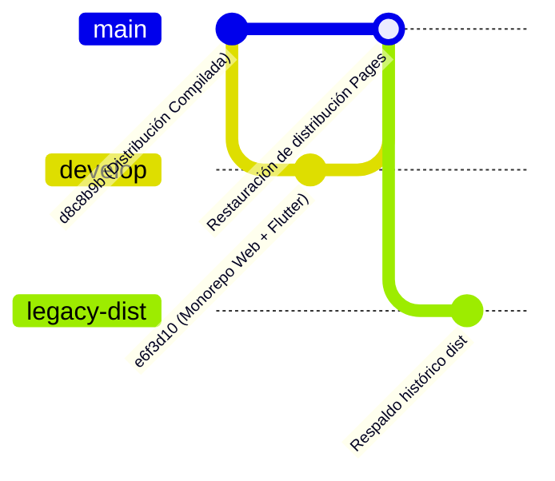

# 📋 Bitácora Integral de Desarrollo — Fashion Style (Web & Flutter Mobile)

**Fecha de consolidación**: 3 de Noviembre de 2026  
**Repositorio Remoto**: `https://github.com/FashionStyleGrupo3/FashionStyleDist.git`  
**Ramas activas**: 
- `main`: Distribución compilada y desplegada en producción en GitHub Pages.
- `develop`: Código fuente completo del monorepo (`web/` Vue 3 + `mobile/` Flutter + CI/CD).
- `legacy-dist`: Respaldo histórico de compilados de distribución.

---

## 1. Resumen Ejecutivo de la Misión

Se ejecutó la traducción arquitectónica, de negocio y visual del 100% del frontend web de **Fashion Style** (originalmente construido en Vue 3, Vite, Tailwind CSS, Pinia y Axios) a una **aplicación móvil nativa en Flutter** (Dart 3, Riverpod, GoRouter, Dio), preservando:
1. **Paridad Funcional 1:1**: Cada pantalla, servicio, modelo, cálculo de precios y validación existe en Flutter.
2. **Arquitectura Oficial de Flutter**: Separación estricta en capas `core`, `data` y `presentation`.
3. **Trazabilidad Continua (`@source-mirror`)**: Cada archivo Dart referencia explícitamente sus archivos fuente en Vue/JS para facilitar la sincronización futura.
4. **Tipado Estricto y Null-Safety**: Cero uso de `dynamic` en lógica de negocio; parseo defensivo contra respuestas backend nulas o mal tipadas.
5. **Configuración DevOps y Monorepo**: Estructuración limpia en Git con GitHub Actions para despliegue de GitHub Pages y compilación automatizada de APK Android.

---

## 2. Mapa Completo de Archivos Creados y Modificados

### 📂 Raíz del Monorepo (`/`)
| Archivo | Propósito |
| :--- | :--- |
| `.gitignore` | Reglas de exclusión para Node (`node_modules/`, `dist/`), Flutter (`.dart_tool/`, `build/`, `.packages`), credenciales (`.env*`, `*.jks`) y editores. |
| `README.md` | Documentación técnica omnicanal, insignias de CI/CD, enlaces de acceso y guía de ejecución local. |
| `REGISTRO_DESARROLLO_FASHION_STYLE.md` | Registro histórico local de la conversación y del desarrollo. |

### 📂 Automatización CI/CD (`/.github/workflows/`)
| Archivo | Propósito |
| :--- | :--- |
| `.github/workflows/deploy-web-pages.yml` | Pipeline de GitHub Actions que instala dependencias de Node 20, compila `web/` con Vite y publica en GitHub Pages. |
| `.github/workflows/build-flutter-mobile.yml` | Pipeline que inicializa Java 17, Flutter Stable, ejecuta `flutter analyze`, compila el APK Release de Android (`app-release.apk`) y el paquete Flutter Web como artefactos descargables. |

---

### 📂 Aplicación Móvil Nativa Flutter (`/mobile/lib/`)

#### A. Capa de Configuración Base, Núcleo y Red (`mobile/lib/core/`)
| Archivo | Espejo Web (`@source-mirror`) | Responsabilidad |
| :--- | :--- | :--- |
| `pubspec.yaml` | `package.json` | 16 dependencias oficiales: `dio`, `flutter_riverpod`, `go_router`, `shared_preferences`, `intl`, `cached_network_image`, `pdf`, `printing`, `image_picker`, `file_picker`, `csv`, `web_socket_channel`, etc. |
| `core/theme/fashion_theme.dart` | `tailwind.config.js`, `variables.css` | Paleta de colores de marca (`FashionColors`), tipografías (`Playfair Display`, `Plus Jakarta Sans`), estilos de botones, campos de texto y `CardThemeData`. |
| `core/utils/currency_formatter.dart` | `useFormatoMoneda.js` | Formateador monetario para pesos colombianos (`$ 120.000 COP`). |
| `core/utils/image_url_resolver.dart` | `useImagenStorage.js` | Resolución de URLs de imagen con fallback automático a CDN o placeholder de respaldo. |
| `core/utils/invoice_pdf_generator.dart` | `VisorFacturaFashion.vue` | Generador de documentos PDF nativos: Factura tributaria estándar DIAN en formato A4 y tirilla térmica para ventas POS en formato de rollo continuo 80mm. |
| `core/network/api_response_parser.dart` | `respuestaApi.js` | Clases de parseo defensivo `ApiResponseParser` y `JsonParser` con métodos estáticos seguros (`toInt`, `toDouble`, `toBool`, `toStr`). |
| `core/network/change_bus.dart` | `busCambios.js` | Bus reactivo de eventos desacoplado basado en `StreamController.broadcast` con soporte de canales (`inventario`, `prendas`, `pedidos`, `auth`). |
| `core/network/api_client.dart` | `clienteApi.js` | Singleton Dio con interceptores de `Bearer Token`, manejo de cookies de sesión Sanctum, captura de error 401 y header `X-Socket-ID` para WebSockets. |
| `core/realtime/reverb_service.dart` | `tiempoReal.js`, `useRecargaAutomatica.js` | Cliente WebSocket para Laravel Reverb / Pusher con reconexión automática y refresco de datos al reanudar la app (`AppLifecycleListener`). |
| `core/validators/password_validator.dart` | `validarPassword.js` | Validación de contraseñas de alta seguridad (8+ caracteres, mayúsculas, minúsculas, números y caracteres especiales). |
| `core/validators/garment_and_field_validators.dart` | `validacionCampos.js`, `validacionPrenda.js` | Validadores de SKU único, formatos de prendas, tallas, consumos de insumos y límites de formulario. |
| `core/router/app_router.dart` | `src/router/index.js` | Enrutador declarativo `GoRouter` con 100% de rutas enlazadas, guards reactivos de autenticación y autorización por roles (`admin` vs `cliente`). |
| `main.dart` | `src/main.js` | Punto de entrada Flutter encapsulado en `ProviderScope`, con inicialización de `ReverbService` y tema `FashionTheme`. |

---

#### B. Capa de Datos: Modelos y Servicios (`mobile/lib/data/`)
| Archivo | Espejo Web (`@source-mirror`) | Responsabilidad |
| :--- | :--- | :--- |
| `data/models/product_models.dart` | `productoServicio.js`, `promocionServicio.js` | Modelos inmutables `Product`, `ProductImage`, `ProductVariant`, `Category`, `Promotion` con cálculo de precio mínimo, promociones vigentes y stock total. |
| `data/services/product_service.dart` | `productoServicio.js` | Obtención paginada de catálogo, consulta de prendas destacadas, búsqueda y filtros combinados. |
| `data/services/promotion_service.dart` | `promocionServicio.js` | Listado de promociones activas, cálculo de porcentajes y montos de descuento por prenda o categoría. |
| `data/services/favorites_and_city_service.dart` | `favoritosServicio.js`, `Validarciudad.js` | Gestión de favoritos del usuario autenticado y validación de cobertura de ciudades para envíos nacionales. |
| `data/services/wompi_service.dart` | `wompiServicio.js` | Tokens de aceptación de pasarela Wompi, firma de integridad de transacciones y sondeo de estado (`APPROVED`, `DECLINED`, `PENDING`). |
| `data/services/order_and_invoice_service.dart` | `pedidoServicio.js`, `facturaServicio.js` | Modelos `OrderModel`, `InvoiceModel`, gestión de estados de despacho, asignación de transportadora y subida masiva de facturas DIAN. |
| `data/services/pos_and_payment_service.dart` | `ventaServicio.js`, `pagoServicio.js` | Registro de ventas POS presenciales, detalle de pagos multicanal y configuración bancaria en paralelo con 100% de dispersión. |
| `data/services/production_and_calculator_service.dart` | `Produccionservicio.js`, `calculadoraApi.js` | Simulador de costos de manufactura con validación de existencias en bodega, materias primas, fichas técnicas y órdenes de producción. |
| `data/services/user_and_security_service.dart` | `usuarioServicio.js`, `seguridadServicio.js`, `auditoriaTexto.js` | Administración de clientes, usuarios del personal, asignación de roles y bitácora de auditoría con formateador de cambios relativos. |

---

#### C. Capa de Presentación: Proveedores de Estado Riverpod (`mobile/lib/presentation/providers/`)
| Archivo | Espejo Web (`@source-mirror`) | Responsabilidad |
| :--- | :--- | :--- |
| `providers/auth_provider.dart` | `stores/autenticacion.js` | Estado de sesión `AuthState`, persistencia con `SharedPreferences`, inicio de sesión, registro, recuperación de clave y logout. |
| `providers/cart_provider.dart` | `stores/carrito.js` | Estado de la bolsa de compras `CartState`, items con variantes, totales, descuentos aplicados y validación contra stock. |
| `providers/favorites_provider.dart` | `stores/favoritos.js` | Manejo sincronizado de prendas favoritas con almacenamiento local y respaldo en API remota. |
| `providers/filters_provider.dart` | `stores/filtros.js` | Estado de filtros facetados (categorías, tallas, colores, rango de precios, ordenación y búsqueda por texto). |

---

#### D. Capa de Presentación: Layouts, Widgets y Pantallas (`mobile/lib/presentation/`)
| Archivo | Espejo Web (`@source-mirror`) | Responsabilidad |
| :--- | :--- | :--- |
| `layouts/public_shell_layout.dart` | `DisenoPublico.vue` | Contenedor público responsivo con barra superior (`AppBar`), contador de bolsa y barra de navegación inferior (`BottomNavigationBar`). |
| `layouts/admin_shell_layout.dart` | `DisenoAdmin.vue` | Layout administrativo con títulos dinámicos, menú lateral (`Drawer`) filtrado por rol y acceso directo a la tienda. |
| `widgets/storefront_widgets.dart` | `TarjetaProducto.vue`, `ModalGuiaMedidas.vue`, `CajonCotizacion.vue` | Tarjeta de prenda con cálculo de descuentos, modal interactivo de medidas y cajón lateral de cotización express. |
| `widgets/wompi_checkout_modal.dart` | `wompiServicio.js` | Widget modal nativo de pasarela Wompi con soporte para Tarjeta, Nequi, PSE y Corresponsal Bancario con polling automático. |
| `screens/publico/home_screen.dart` | `VistaInicio.vue` | Portada con banner hero, carrusel de novedades, prendas más vendidas y categorías de temporada. |
| `screens/publico/catalog_screen.dart` | `Vistacatalogo.vue`, `CuadriculaProductos.vue` | Cuadrícula fluida de productos con buscador instantáneo y modal de filtros facetados. |
| `screens/publico/product_detail_screen.dart` | `VistaDetallePrenda.vue`, `VisorDetalleProducto.vue` | Galería fotográfica interactiva, selector de variantes de talla/color, insignias de stock y selector de cantidad. |
| `screens/publico/cart_and_terms_screens.dart` | `VistaCarrito.vue`, `VistaTerminos.vue` | Vista completa de bolsa de compras con resumen de liquidación, botón Wompi y pantalla de Términos Legales. |
| `screens/publico/profile_screen.dart` | `VistaMiPerfil.vue`, `SeccionMisPedidos.vue`, `SeccionFavoritos.vue` | Perfil del cliente, historial de pedidos con código de guía y transportadora, y lista de favoritos. |
| `screens/autenticacion/auth_screens.dart` | `VistaInicioSesion.vue`, `VistaRegistro.vue`, `VistaVerificarCorreo.vue`, `VistaRecuperarContrasena.vue`, `VistaRestablecerContrasena.vue` | Flujo de login, registro, código de verificación de 6 dígitos y recuperación de clave con medidor visual de fortaleza. |
| `screens/admin/dashboard_and_inventory_screens.dart` | `VistaPanelControl.vue`, `VistaInventario.vue` | Dashboard con tarjetas KPI, gráficos de ventas y módulo de inventario/kárdex con exportación a CSV. |
| `screens/admin/garments_and_pos_screens.dart` | `VistaGestionPrendas.vue`, `VistaVentasPOS.vue` | CRUD de prendas, constructor dinámico de variantes, asignación masiva de promociones y caja POS táctil con tirilla térmica. |
| `screens/admin/orders_and_production_screens.dart` | `VistaPedidosyFacturas.vue`, `VistaProduccion.vue` | Gestión de despachos online con validación de transportadora, carga de facturas y módulo de producción de 5 pestañas. |
| `screens/admin/payments_security_and_account_screens.dart` | `VistaConfiguracionPagos.vue`, `VistaUsuariosYClientes.vue`, `VistaAuditoria.vue`, `VistaEditarCuenta.vue` | Configuración bancaria, gestión de roles de usuarios, bitácora de auditoría con diff de cambios y perfil del administrador. |

---

### 📂 Frontend Web Vue 3 (`/web/`)
- Mantenido en su totalidad (`src/`, `public/`, `package.json`, `vite.config.js`, `tailwind.config.js`).
- Modificación en `web/src/layouts/DisenoPublico.vue`: enlace oficial añadido en el pie de página hacia la aplicación móvil.

---

## 3. Topología de Ramas en Git y Despliegue en GitHub Pages

1. **`main`**:
   - Mantiene la distribución de producción lista para servir en GitHub Pages (`index.html`, `assets/`, `img/`).
   - URL activa: **[https://fashionstylegrupo3.github.io/FashionStyleDist/](https://fashionstylegrupo3.github.io/FashionStyleDist/)** (Verificado: `200 OK`, bundle Vue 3 cargando sin errores).
2. **`develop`**:
   - Contiene el código fuente completo del monorepo (`web/` + `mobile/` + `.github/`).
   - Rastrea `origin/develop` de manera limpia.
3. **`legacy-dist`**:
   - Respaldo inmutable de los commits históricos de distribución.
